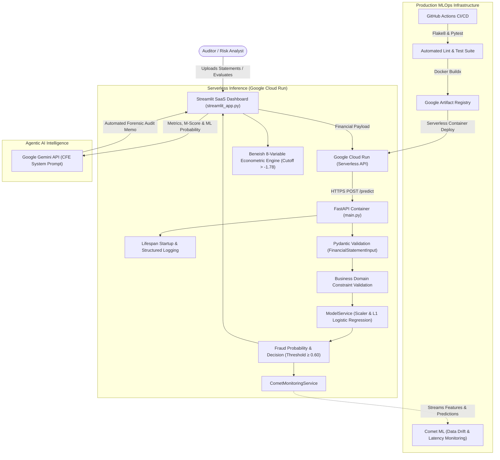
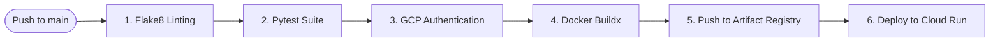

# Real-Time Corporate Fraud Inference API & SaaS Dashboard

<p align="center">
  <a href="http://localhost:8501" target="_blank">
    
  </a>
  <a href="https://fraud-inference-service-424ikcmnya-uc.a.run.app/docs" target="_blank">
    
  </a>
  <a href="https://github.com/features/actions" target="_blank">
    
  </a>
  <a href="https://cloud.google.com/run" target="_blank">
    
  </a>
  <a href="https://www.comet.com" target="_blank">
    
  </a>
</p>

An end-to-end, production-grade financial forensic intelligence system for detecting corporate earnings manipulation and financial statement fraud. 

Combines a **FastAPI containerized microservice** running an L1-penalized Logistic Regression model, an **8-variable Beneish M-Score econometric engine**, **production model monitoring via Comet ML**, an **automated GCP Cloud Run CI/CD pipeline**, a **Streamlit SaaS Dashboard**, and **Agentic AI commentary powered by Google Gemini**.

---

## 🎯 Architecture



---

## 📂 Project Structure

```text
Financial Statement Fraud Detection/
├── .github/
│   └── workflows/
│       └── gcp-deploy.yml          # GitHub Actions CI/CD pipeline (Lint, Test, Artifact Registry, Cloud Run)
├── app/
│   ├── core/
│   │   ├── config.py               # Centralized typed environment & application configuration
│   │   └── logging_config.py       # Production structured logging (ISO-8601 & JSON for Cloud Logging)
│   ├── schemas/
│   │   └── fraud.py                # Pydantic v2 schemas, alias mapping & business constraint validation
│   └── services/
│       ├── model_service.py        # ML inference service (artifact management, scaling & predictions)
│       └── monitoring_service.py   # Comet ML production model monitoring (inputs, outputs & drift)
├── tests/
│   └── test_api.py                 # Automated test suite (health checks, inference, domain rules)
├── lr_fraud_model.joblib           # Pre-trained L1-Penalized Logistic Regression model
├── scaler.joblib                   # Pre-fitted StandardScaler transformation artifact
├── main.py                         # Production FastAPI application entrypoint with lifespan events
├── streamlit_app.py                # Interactive Streamlit SaaS dashboard
├── sample_financial_statements.csv # Sample fictitious financial data for testing
├── Dockerfile                      # Cloud Run optimized multi-stage container image listening on $PORT
├── .dockerignore                   # Build context exclusions for lean container packaging
└── requirements.txt                # Pinned production and development dependencies
```

---

## 🔬 Production MLOps Features

### 1. Model Monitoring with Comet ML
The inference service streams inputs and outputs to **Comet ML** to provide continuous production model observability:
* **Feature Tracking**: Streams all 12 financial indices and accounting variables (`input_DSRI`, `input_AQI`, `input_TATA`, `input_Sales_t`, etc.) across sequential steps to monitor for data drift and distributional shifts.
* **Prediction Observability**: Logs `fraud_probability`, classification decisions (`is_fraudulent`), and execution latency (`inference_latency_ms`).
* **Resilient & Non-Blocking**: Inference execution is decoupled from telemetry; network drops or rate limits to Comet ML will never disrupt customer predictions.
* **Mock / Offline Mode**: If `COMET_API_KEY` is not provided, the service operates in mock mode with structured warnings.

### 2. Structured Logging
* Completely eliminates unformatted `print()` statements.
* Uses Python's standard `logging` module formatted with UTC ISO-8601 timestamps, log severity levels, module/function names, and line numbers.
* Setting `LOG_JSON_FORMAT=true` (default in Cloud Run) outputs structured JSON strings automatically parsed and indexed by **Google Cloud Logging**.

### 3. Business Rule Constraint Validation
Enforces accounting sanity checks before data reaches the model:
* Gross sales (`Sales(t)`) must be non-negative.
* Trade accounts receivable (`Receivables-Net(t-1)`) must be non-negative.
* Key financial ratios (`DSRI`, `AQI`, `DEPI`, `SGI`, `GMI`, `SGAI`, `LVGI`) must be finite and non-negative.
* Violations return clean **HTTP 400 Bad Request** errors with descriptive explanations.

---

## 🚀 Live Demo & Step-by-Step Walkthrough

Follow these steps to launch and test the interactive Streamlit SaaS dashboard:

### Step 1: Clone & Install Dependencies

Ensure Python 3.10+ is installed, then install required packages:

```bash
pip install -r requirements.txt
```

### Step 2: (Optional) Set Environment Variables

```bash
# Windows PowerShell:
$env:GEMINI_API_KEY="your-gemini-api-key"
$env:COMET_API_KEY="your-comet-api-key"

# Linux / macOS Bash:
export GEMINI_API_KEY="your-gemini-api-key"
export COMET_API_KEY="your-comet-api-key"
```

> **Note:** If you don't set environment variables, you can still enter your Gemini API key in the dashboard sidebar, and Comet ML will run in mock mode.

### Step 3: Run the FastAPI Inference API Locally (Optional)

```bash
# Start FastAPI on port 8000
python main.py
# or using uvicorn directly:
uvicorn main:app --reload --host 0.0.0.0 --port 8000
```

### Step 4: Launch the Streamlit Dashboard

In a separate terminal, run:

```bash
streamlit run streamlit_app.py
```

The application will open automatically in your browser at:
👉 **[http://localhost:8501](http://localhost:8501)**

---

## 🖥️ Using the Dashboard (Interactive Tour)

### 1. Configure the API Backend
* In the **sidebar**, select the backend target:
  * **Live Production Cloud Run**: `https://fraud-inference-service-424ikcmnya-uc.a.run.app` (pre-configured with Google-managed SSL).
  * **Local FastAPI**: `http://localhost:8000`.
* Click **"🔌 Ping API Health"** to verify connection status, model readiness, and latency in real time.

### 2. Ingest Financial Statements
You can test the system using three methods:
* **One-Click Demo Data**: Click **"📥 Load Fictitious Demo Companies"** in the sidebar to load three pre-built company scenarios (Aggressive Manipulator, Clean Blue-Chip, Borderline Tech).
* **Upload Sample CSV**: Upload [`sample_financial_statements.csv`](sample_financial_statements.csv) directly via the upload area.
* **Custom Excel/CSV**: Download the starter CSV or Excel `.xlsx` template from the sidebar, fill in your financial figures, and drag & drop it into the uploader.

### 3. Review Dual-Engine Visual Analytics
* **Fraud Probability Gauge**: Interactive Plotly gauge showing ML model probability, categorized into Low (0–30%), Moderate (30–60%), and High Risk / Flagged (60–100%) against the 60% optimal decision boundary.
* **Beneish M-Score Gauge**: Visual indicator comparing the 8-variable econometric score against the $-1.78$ threshold ($M > -1.78$ flags earnings manipulation).
* **Consensus Verdict Card**: Synthesizes both engines into an executive triage verdict (**Critical**, **Caution**, or **Clean**).
* **Ratio Breakdown Chart**: Horizontal bar chart comparing all 8 Beneish indices against normal baselines ($1.0$).
* **Color-Coded Forensic Table**: Formatted dataframe and metric cards highlighting individual anomalous indices:
  * **DSRI > 1.20**: Accelerated revenue recognition or channel stuffing
  * **AQI > 1.25**: Excessive capitalization of operating expenses
  * **GMI > 1.20**: Deteriorating gross margins
  * **TATA > 0.05**: Accounting accruals significantly outstripping operating cash flow
  * **Cash-Gen(t) < 0**: Negative cash flow despite reported profits

### 4. Generate Agentic AI Forensic Insights
* Under **"4. Agentic AI Forensic Insights"**, Gemini analyzes the company's quantitative signals through the lens of a **Certified Fraud Examiner (CFE)**.
* Produces an automated forensic memorandum detailing:
  1. Executive risk diagnosis.
  2. Forensic accounting breakdown of red-flag indices.
  3. Concrete substantive audit procedures (e.g. receivables confirmations, sales cut-off verification, deferred expense audit).

---

## 🧪 Testing & Code Quality

The project enforces strict code quality and includes an automated test suite:

```bash
# 1. Run Flake8 Linter (syntax, error checks, max-line-length=120)
flake8 app/ main.py tests/ --count --max-line-length=120 --statistics

# 2. Run Automated Pytest Test Suite
pytest tests/ -v
```

The test suite validates:
* Service root metadata (`/`)
* Health probe states and artifact readiness (`/health`)
* Correct inference probabilities, decisions, and Beneish scores (`/predict`)
* Business constraint violations (negative sales, negative receivables, negative ratios)
* Pydantic schema validation failures (missing required fields)

---

## 🚢 CI/CD Pipeline (Google Cloud Run & Artifact Registry)

The repository includes a production-ready GitHub Actions workflow in [`.github/workflows/gcp-deploy.yml`](.github/workflows/gcp-deploy.yml):



### GitHub Secrets Required:
| Secret Name | Description | Example |
| --- | --- | --- |
| `GCP_PROJECT_ID` | Google Cloud Project ID | `my-gcp-project-123` |
| `GCP_SA_KEY` | Service Account JSON Key with Artifact Registry & Cloud Run Admin roles | `{ "type": "service_account", ... }` |
| `COMET_API_KEY` | Comet ML API Key for production telemetry | `your_comet_api_key` |

### Cloud Run Container Optimization
The container image is built with [`Dockerfile`](Dockerfile) specifically optimized for Google Cloud Run:
* **Dynamic Port Evaluation**: Listens on the `$PORT` environment variable injected by Cloud Run:
  ```dockerfile
  CMD ["sh", "-c", "exec uvicorn main:app --host 0.0.0.0 --port ${PORT:-8080}"]
  ```
* **Security Hardening**: Runs as an unprivileged user (`USER appuser`).
* **Minimal Footprint**: Layer-cached dependencies and exclusions via [`.dockerignore`](.dockerignore).

---

## 🛠️ Deployment & MLOps Stack

| Component | Technology | Role |
| --- | --- | --- |
| **Front-End SaaS Dashboard** | Streamlit, Plotly, Pandas | Interactive forensic analytics UI |
| **Inference Microservice** | FastAPI, Uvicorn | Real-time REST API for model predictions |
| **Machine Learning Engine** | Scikit-Learn, Joblib | L1-Penalized Logistic Regression classifier |
| **Econometric Model** | Beneish 8-Variable Equation | Classic $-1.78$ Earnings Manipulation Index |
| **Production Model Monitoring**| Comet ML (`comet_ml`) | Continuous tracking of features, drift, latency & outputs |
| **Agentic AI** | Google Gemini (`google-generativeai`) | Automated natural language forensic audit reports |
| **CI/CD Pipeline** | GitHub Actions (`.github/workflows/gcp-deploy.yml`) | Automated linting, testing, Docker build & deployment |
| **Serverless Deployment** | Google Cloud Run & GCP Artifact Registry | Auto-scaling container deployment listening on `$PORT` |
| **Cloud Security** | GCP IAM & Secret Manager | Enterprise-grade access control and secure API key injection |

---

## 🌐 Production API Access (Swagger & cURL)

The FastAPI inference service is running live on Google Cloud Run:

### 1. Interactive Swagger UI
Open [https://fraud-inference-service-424ikcmnya-uc.a.run.app/docs](https://fraud-inference-service-424ikcmnya-uc.a.run.app/docs)

### 2. cURL Command

```bash
curl -X POST "https://fraud-inference-service-424ikcmnya-uc.a.run.app/predict" \
  -H "accept: application/json" \
  -H "Content-Type: application/json" \
  -d '{
    "Receivables-Net(t-1)": 2450.0,
    "Cash-Gen(t)": -410.0,
    "SalesGenAdmExpen - R&Dexpense(t-1)": 1180.0,
    "Sales(t)": 8900.0,
    "AQI": 1.65,
    "DEPI": 1.22,
    "SGI": 1.45,
    "DSRI": 1.88,
    "TATA": 0.19,
    "GMI": 1.42,
    "SGAI": 1.18,
    "LVGI": 1.38
  }'
```

### Example API Response

```json
{
  "fraud_probability": 0.351,
  "is_fraudulent": false,
  "inference_latency_ms": 7.02,
  "beneish_m_score": 0.3489
}
```

---

## ⚠️ Notes & Limitations

- **Imbalanced Dataset**: The underlying ML model was trained on 2,012 observations with an approximate 98:2 class ratio; probability outputs should be interpreted alongside the Beneish M-Score and operational cash flows.
- **Investigative Aid**: This system serves as a high-sensitivity early warning filter for auditors, forensic accountants, and compliance teams. Flagged cases warrant substantive audit review and do not constitute definitive legal proof of fraud.
- **Managed SSL**: Production traffic is secured via Google Cloud Run's automated, managed TLS/SSL certificates—no manual SSL bypass or self-signed certificate handling required.
